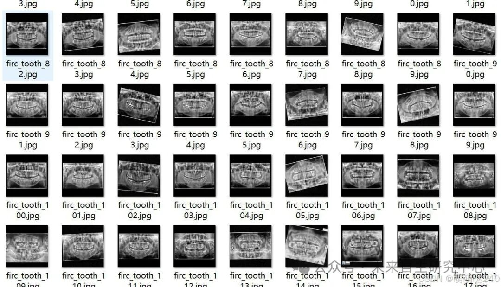
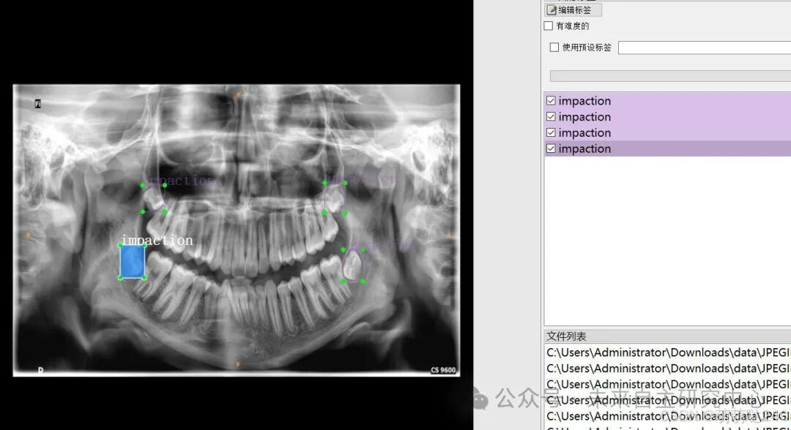

# VOC+YOLO format: 5040 images for dental CT health status detection dataset with 6 categories

Important note: The dataset section has been enhanced, accounting for approximately one-third of the total.

Dataset format: Pascal VOC format + YOLO format (txt file without split path, only containing jpg images and corresponding VOC format xml files and yolo format txt files)
Number of images (jpg file count): 5040
Number of annotations (xml file count): 5040
Number of annotations (txt file count): 5040
Number of annotation categories: 6
Annotation category names: ["Prosthesis", "Root Canal", "caries", "impaction", "restoration", "root stump"]
Number of bounding boxes per category:
Prosthesis = 4770
Root Canal = 5759
caries = 5242
impaction = 5225
restoration = 5348
root stump = 2052
Total bounding box count: 28396
Labeling tool used: labelImg
Annotation rules: Draw a rectangle around the category
Important note: No guarantee is made regarding the accuracy or weights of the trained model. The dataset provides accurate and reasonable annotations only.

Image Preview:

Annotation example:

## Payment

Here is a pay link on Stripe ( https://buy.stripe.com/3cs8yP7sY87d0vu9AB ). Please contact me lonlonago@foxmail.com after funding $89, and I will send you a complete data files , thank you!

